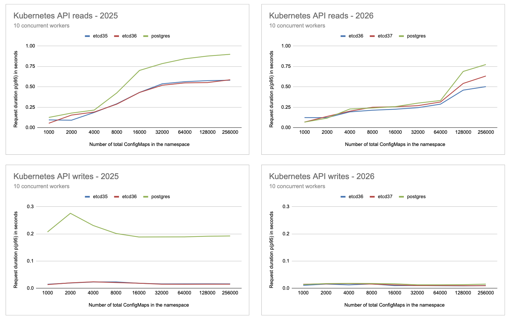
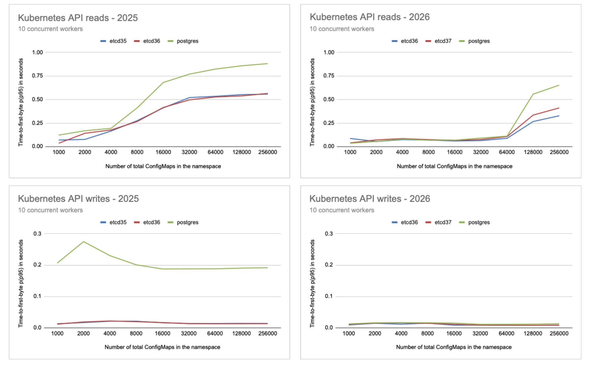

# 2026-10-13 - Comparison between etcd and Postgres via kine for kube-apiserver performance

This is a follow-up to the [2025-05-13 benchmark](20250513%20-%20Kubernetes%20API%20benchmark%20test.md). It re-runs the same load test on the same hardware with newer datastore and RKE2 versions and compares the results.
Another difference from the previous experiment is the omission of a Rancher installation.

Recent changes in kine ([k3s-io/kine#746, "Watch event pipeline refactor"](https://github.com/k3s-io/kine/pull/746)) triggered this new round of measurements. The PR reworks how kine delivers watch events and progress notifications, and removes an artificial delay on progress notification responses, which the PR reports as a source of slowness in the Kubernetes API server.
The goal was to find out whether kine with this change behaves differently from the version RKE2 shipped at the time of the 2025 report (kine v0.13.14, bundled with RKE2 v1.32.4), and how it now compares with etcd. This run uses RKE2 1.37.1, including kine v0.17.1 and the mentioned PR changes.

## TL;DR

This stress test measures the p95 request time of creating and listing ConfigMaps through the Kubernetes API, with the datastore being either a 3-node external etcd (3.6 or 3.7) or a 1-node Postgres behind kine, on identical hardware.

How much faster etcd 3.6 is than Postgres (1x means equally fast):

| | 2025 | 2026 |
|---|---|---|
| Reads, 8,000 to 64,000 ConfigMaps | ~1.5 to 1.6x faster | ~1.1 to 1.25x faster |
| Reads, 128,000 ConfigMaps and above | ~1.5x faster | ~1.5x faster |
| Writes | ~10 to 15x faster | ~1.1 to 1.7x faster (negligible, a few milliseconds) |

Below 8,000 ConfigMaps the differences between datastores are within run-to-run noise in both years.

* **Postgres (via kine) is now close to etcd on reads up to 64,000 ConfigMaps, but at 128,000 and above etcd 3.6 is still ~1.5x faster**, the same gap as in 2025. etcd 3.7 is ~1.25x faster than Postgres at that size.
* **Writes: the large gap seen in 2025 is gone.** Postgres writes are ~13x faster than in 2025 (~0.19 s to ~0.015 s). Every datastore now answers in under 18 ms, with Postgres a few milliseconds behind etcd.
* **Reads are faster than in 2025 for all datastores:** ~1.4 to 2.7x faster between 8,000 and 64,000 ConfigMaps, but only ~1.2x faster at 128,000 and above, and no clear change at 4,000 and below.
* **etcd 3.6 reads are ~1.2 to 1.25x faster than etcd 3.7** at 128,000 and 256,000 ConfigMaps. This comes from a single run per datastore, so treat it as a lead to confirm, not as a conclusion.
* **Time to first byte (the metric used in 2025) overstates the improvement.** In 2026 the API server starts answering much earlier and spends most of the request sending the response, so time to first byte would suggest 7 to 10x faster reads and a wider Postgres gap. See [Time to first byte vs total request time](#time-to-first-byte-vs-total-request-time).
* **The causes of the changes since 2025 are not isolated.** Getting the newer kine (v0.17.1, including #746) required moving RKE2/Kubernetes from v1.32.4 to v1.37.1, and **Rancher was deliberately not installed in 2026** to measure the datastores more directly. Both affect the comparison with 2025, but not the etcd vs Postgres comparison within 2026. See [Caveats](#caveats).

All figures are p(95) total request time; see [Method](#method).

Where to go next:
* [Charts and full data](#detailed-results)
* [Analysis](#analysis), [caveats](#caveats) and [follow-ups](#follow-ups)
* [What changed since 2025](#what-changed-since-2025), [infrastructure](#hardware-and-infrastructure-configuration-outline) and [method](#method)
* [Reproduction instructions](#reproduction-instructions)

## What changed since 2025

| | 2025-05-13 | 2026-10-13 |
|---|---|---|
| etcd | 3.5, 3.6 | 3.6.15, 3.7.2 |
| Postgres via kine | yes, kine v0.13.14 (bundled with RKE2 v1.32.4), Postgres version not recorded | yes, kine v0.17.1, Postgres 15.19 |
| RKE2 | v1.32.4 | v1.37.1+rke2r1 |
| Rancher | 2.11.1 installed | **not installed** (the load test talks to the Kubernetes API directly and does not need it) |
| Hardware | see below | same instance types and node counts |

etcd 3.6 and Postgres appear in both runs, so they are the series to compare across years. etcd 3.5 was dropped and etcd 3.7 was added. The hardware was deliberately kept the same so the two runs are comparable. Rancher was deliberately left out in 2026: its controllers and watches add load to kube-apiserver and the datastore, so the 2026 clusters were running with less background activity (see [Caveats](#caveats)).

## Hardware and infrastructure configuration outline

The specs are the same as in the 2025 run, to allow comparing both. Scenarios provisioned on AWS (`us-east-1a`), as defined in [aws_dedicated_etcd.yaml](../darts/aws_dedicated_etcd.yaml) and [aws_kine_postgres.yaml](../darts/aws_kine_postgres.yaml):

* Upstream RKE2 cluster under test (Rancher was not installed on it in this run):
    * 3 CP Nodes: `i3.xlarge` instances (4 vCPUs, 30GB RAM, 50 GB root volume)
    * 1 Agent Node: `i3.xlarge` instance (4 vCPUs, 30GB RAM, 50 GB root volume)

* For etcd:
    * `m6id.4xlarge` instances (16 vCPUs, 64GB RAM, dedicated 950 GB NVMe SSD, 50 GB root volume). 3 nodes, as in 2025 (the dart file does not set the count, so the etcd Tofu module default of 3 applies).

* For Postgres:
    * 1 Node: `m6id.4xlarge` instance (16 vCPUs, 64GB RAM, dedicated 950 GB NVMe SSD, 50 GB root volume)

* Tester cluster (runs k6): 1 `t3a.large` node running k3s v1.37.1+k3s1

As in 2025, an HA configuration for Postgres is not part of this test. It can be assumed that any multi-node setup can only make Postgres slower in write performance. Reads could be slower or faster depending on setup.

## Software configuration outline

- RKE2 cluster and tester cluster hosts run openSUSE Leap 15.6 (`v20250408` image)
- etcd and Postgres hosts run Amazon Linux 2 (kernel 5.10, `2.0.20250428.0` image)
- RKE2 v1.37.1+rke2r1
  - loaded with: 1000 to 256000 small (4-byte data) ConfigMaps
- etcd: v3.6.15 and v3.7.2 (the same dart file was used for both, changing `etcd_version`)
- Postgres 15.19

## Method

For each of the three scenarios:
* automated infrastructure deployment (no Rancher installation in this run)
* automated test execution with [util/test_runner.sh](../util/test_runner.sh)
* semi-automated analysis of results

`test_runner.sh` doubles the number of ConfigMaps from 1,000 up to 256,000. At each step it:
1. deletes and recreates the `scalability-test` namespace, then creates the ConfigMaps (10 concurrent virtual users, 4-byte data, plus 10 Secrets),
2. waits `count/300` seconds for the system to settle,
3. warms up with 5 list iterations from 1 virtual user,
4. measures with 10 virtual users doing 30 list iterations each.

A list iteration is a paginated `GET /api/v1/namespaces/scalability-test/configmaps` with `limit=5000`, following continue tokens (see [k6/k8s_api_benchmark.js](../k6/k8s_api_benchmark.js)). Every page is one HTTP request and one sample, so **read figures are per page of up to 5,000 ConfigMaps, not per full list**: listing all 256,000 ConfigMaps takes 52 consecutive requests.

Metrics reported, both as p(95) (95% of requests took this long or less):
* **Total request time** (k6's `http_req_duration`): from sending the request until the full response is received. This is the main metric in this report.
* **Time to first byte** (k6's `http_req_waiting`): from sending the request until the first response byte is received. This was the metric used in the 2025 report. In 2025 both metrics were almost identical, in 2026 they are not (see [Time to first byte vs total request time](#time-to-first-byte-vs-total-request-time)).
* For writes, each ConfigMap creation is one request. Both metrics are nearly identical for writes.

## Detailed results

Total request time:



Time to first byte:



The graphs compare the 2025 run (left: etcd 3.5, etcd 3.6, Postgres) with the 2026 run (right: etcd 3.6, etcd 3.7, Postgres), for reads (top) and writes (bottom), using p(95) values. In both sets of graphs, the y axis range is shared by the two reads charts, and by the two writes charts, so the two years can be compared visually. At that scale the 2026 write lines overlap; the spreadsheet linked below shows the differences between them.

Full results are available in the folder [20261013 - Kubernetes API benchmark test results](20261013%20-%20Kubernetes%20API%20benchmark%20test%20results), in particular [k6_results.csv](20261013%20-%20Kubernetes%20API%20benchmark%20test%20results/k6_results.csv). The 2025 data is in [its own folder](20250513%20-%20Kubernetes%20API%20benchmark%20test%20results).

The charts were generated from this [spreadsheet](https://docs.google.com/spreadsheets/d/1eBa2V5RdUa4p3bSF9C-8bnEIf2UrCbx9X_FerL06FLI/edit?usp=sharing), which also contains the pivot tables with all values for both years.

## Analysis

All figures in this section are total request time unless stated otherwise.

### Reads
* Up to 64,000 ConfigMaps all datastores are within ~0.06 s of each other (0.07 to 0.33 s). From 4,000 on, etcd 3.6 is always the fastest and Postgres usually the slowest, with etcd 3.6 ~1.15 to 1.25x faster than Postgres at 16,000 to 64,000. At 1,000 and 2,000 the order is not consistent, which is what noise looks like.
* All three show a clear step between 64,000 and 128,000 ConfigMaps. Postgres is hit hardest: 0.33 s to 0.69 s (2.1x), against 1.6x for etcd 3.6 and 1.7x for etcd 3.7.
* Above the step, etcd 3.6 is ~1.5x faster and etcd 3.7 ~1.25x faster than Postgres, at both 128,000 and 256,000.
* etcd 3.6 is faster than etcd 3.7 at every size from 4,000 on: ~1.05 to 1.17x faster up to 64,000, and 1.18x (128,000) and 1.26x (256,000) faster above. The consistency suggests a real effect, but with a single run per datastore this is not established.

### Writes
* Write time is flat and low for every datastore, under 18 ms at all sizes, and does not grow with the number of ConfigMaps.
* At 128,000+ ConfigMaps etcd is ~1.4 to 1.6x faster than Postgres (for example 0.0149 vs 0.0097 s at 256,000), a gap of about 4 to 5 ms. At smaller sizes the ordering is not consistent.
* In 2025 etcd writes were >10x faster than Postgres (~0.015 s vs ~0.19 s), with a remarkably flat ~0.19 s at every size, which looks more like a fixed delay or contention than a cost growing with load. That gap has closed: Postgres writes are ~13x faster than a year ago (0.192 to 0.015 s at 256,000), while etcd 3.6 is ~1.5x faster (0.0149 to 0.0097 s).
* The much larger improvement on the Postgres side is consistent with the kine changes (v0.13.14 to v0.17.1, including [#746](https://github.com/k3s-io/kine/pull/746)), but also with the absence of Rancher: its constant background writes may have weighed more on a single Postgres node than on a 3-node etcd cluster. This test cannot tell these apart (see [Caveats](#caveats)).

### 2025 vs 2026
* In 2025, read time increased steadily from ~4,000 to 32,000 ConfigMaps. Above 32,000 it stayed almost the same (~0.52 to 0.59 s for etcd 3.6, ~0.78 to 0.90 s for Postgres).
* In 2026, read time increases slowly up to 64,000 ConfigMaps, and then jumps between 64,000 and 128,000.
* The largest improvements are in the middle of the range: between 8,000 and 64,000 ConfigMaps etcd 3.6 is ~1.4 to 2.1x faster and Postgres ~1.8 to 2.7x faster. At 128,000 and 256,000 both are only ~1.2x faster. At 4,000 and below there is no consistent change.
* The read gap between etcd 3.6 and Postgres closed in the middle of the range (at 16,000, etcd 3.6 was 1.63x faster in 2025 and 1.14x faster in 2026), but not at the top (at 256,000: 1.53x faster in 2025, 1.54x faster in 2026).

### Time to first byte vs total request time
The 2025 report used time to first byte. In 2025 it was within a few percent of total request time, so the choice did not matter. In 2026 the two diverge strongly for reads:

| Reads, p(95) in seconds | etcd 3.6, TTFB | etcd 3.6, total | Postgres, TTFB | Postgres, total |
|---|---:|---:|---:|---:|
| 16,000 ConfigMaps, 2025 | 0.416 | 0.430 | 0.681 | 0.700 |
| 16,000 ConfigMaps, 2026 | 0.061 | 0.225 | 0.069 | 0.257 |
| 256,000 ConfigMaps, 2025 | 0.565 | 0.586 | 0.882 | 0.898 |
| 256,000 ConfigMaps, 2026 | 0.328 | 0.502 | 0.653 | 0.773 |

In 2026 the API server sends the first bytes much earlier and spends most of the request transferring the rest of the response. A likely explanation is the streaming encoding of LIST responses introduced in recent Kubernetes versions, which writes items out as they are encoded instead of building the whole response first. This has not been verified for this setup.

As a consequence, time to first byte overstates the 2025 to 2026 improvement (7 to 10x faster at 16,000 ConfigMaps, against ~1.9 to 2.7x in total time) and suggests a wider Postgres vs etcd gap at 256,000 (etcd 3.6 2.0x faster than Postgres, against 1.5x in total time). Total request time is closer to what clients experience, and it is the metric used for conclusions in this report.

### Do reads still reach the datastore?
Recent Kubernetes versions can serve LIST requests, including paginated ones, from the API server's in-memory watch cache, and only ask the datastore to confirm the cache is up to date (via watch progress notifications). If that is happening here, it would explain why all datastores perform alike up to 64,000 ConfigMaps. It would also make kine's progress notification handling, the subject of #746, directly relevant to read latency. It would mean, too, that the read test now measures the API server more than the datastore. This has not been verified: the API server's storage and watch cache metrics during a run would show it.

## Caveats

* **Single run per datastore and size.** No repetitions, so there is no estimate of run-to-run variance. Differences of a few tens of milliseconds, particularly at small sizes, should not be interpreted (for example, 1,000 ConfigMaps: etcd 3.6 0.123 s vs etcd 3.7 0.067 s, same hardware and a similar software stack).
* **A newer kine required a much newer Kubernetes.** kine is bundled with RKE2, so in order to test a newer kine (including #746) RKE2 was moved from v1.32.4 to v1.37.1: five Kubernetes minor versions. The API server changed a lot in that time (for example in how it encodes and serves LIST responses, see [Analysis](#analysis)), and those changes affect etcd and Postgres alike. As a result, the differences between 2025 and 2026 cannot be attributed to kine alone, or to #746 in particular. This does not affect the etcd vs Postgres comparison within the 2026 run, since both use the same Kubernetes version.
* **Rancher was not installed in 2026, unlike in 2025.** The main goal of this run is an accurate comparison of etcd and Postgres via kine. The comparison with 2025 is a secondary goal. Rancher's controllers add background load on the API server and the datastore that has nothing to do with the test, so it was deliberately left out to measure the datastores more directly, even if that makes the comparison with 2025 less clean. Part of the 2025 to 2026 improvement, especially for Postgres writes, may come from this missing background load.
* **Same instance types, but not necessarily the same physical hosts.** An instance type fixes the CPU generation, but host-level variance (noisy neighbours, disk performance) between the two runs cannot be ruled out. No CPU, memory or disk metrics were collected, so resource usage is not compared.
* **Postgres is a single node**, with no HA, as in 2025.

## Follow-ups

Ordered by how much they would improve confidence in the conclusions.

Make the current results more reliable:
* **Repeat each run 3 or more times.** This gives an estimate of run-to-run variance, which is needed to tell real differences from noise, for example the etcd 3.6 vs 3.7 read difference.
* **Collect CPU, memory and disk metrics** on the datastore and control plane nodes, to see which resource limits each datastore at large sizes.

Understand what the test actually measures:
* **Check whether reads are served from the API server's watch cache**, using API server metrics during the read test (see [Do reads still reach the datastore?](#do-reads-still-reach-the-datastore)). If they are, add a read scenario that is served by the datastore, otherwise the read test mostly measures the API server.
* **Start every step from a clean datastore.** Today the namespace is deleted and recreated at every step, so it always holds exactly the stated number of ConfigMaps, but the datastore may still hold deleted objects from previous steps until compaction removes them. This can affect the larger sizes, and kine/Postgres possibly more than etcd. Forcing a compaction before each step, or using a fresh datastore per size, would remove this effect.
* **Isolate the effect of kine.** Run Postgres with only the kine version changing (a release before #746 and one after it) on the same Kubernetes version, for instance by running kine standalone in front of Postgres.
* **Add sizes between 64,000 and 256,000** to locate the step in read time more precisely.

Cover more realistic scenarios:
* **Use more heterogeneous data samples.** Thousands of tiny (4-byte) ConfigMaps in a single namespace is a synthetic scenario. Real workloads spread objects across many namespaces and mix object types and sizes.
* **Test an HA Postgres setup**, if a multi-node Postgres is a relevant deployment option.

## Full configuration details

All infrastructure is defined by the [aws_dedicated_etcd.yaml](../darts/aws_dedicated_etcd.yaml) and [aws_kine_postgres.yaml](../darts/aws_kine_postgres.yaml) dart files and accompanying [OpenTofu](https://opentofu.org/) files in the [tofu](../tofu) directory. To run etcd 3.7, set `etcd_version` in the etcd dart file to `v3.7.2`.

[k6](https://k6.io) load test scripts are defined in the [k6](../k6) directory.

Utility scripts that orchestrate load tests are defined in the [util](../util) directory.

## Reproduction Instructions

### Requirements

Same as dartboard and the AWS CLI tool.

### Setup

Log into AWS via the CLI:
  - for SUSE employees: log into [OKTA](https://suse.okta.com), click on "AWS Landing Zone", retrieve the profile name, then use `aws sso login --profile AWSPowerUserAccess-<IDENTIFIER>`

Provision the environment and set up clusters for tests:
```shell
# clone this project
git clone https://github.com/rancher/dartboard.git
cd dartboard

# edit the AWSPowerUserAccess identifier
vim darts/aws_kine_postgres.yaml   # or darts/aws_dedicated_etcd.yaml

make

./dartboard -d ./darts/aws_kine_postgres.yaml apply   # or aws_dedicated_etcd.yaml
```

### Run tests

Once the system is provisioned, open a `k6` shell and pod on the tester cluster:
```shell
bash util/k6_shell.sh
```

This script will initialize a k6shell pod in the tester cluster, running the `util/test_runner.sh` script, and watch the logs.
Result files are written to a volume directory `/results`.

At the end of the run the pod will keep running indefinitely. From another shell, copy result files out of the container with:

```shell
kubectl cp -n tester k6shell:/results /path/to/results
```

#### Interpreting results
important output data points are:
 * `✓ checks`: number of successful checks. Presence of any errors invalidates the test
 * `http_req_duration`: total duration of http requests (for reads, retrieving a page of up to 5000 resources), the main metric used in this report
 * `http_req_waiting`: time to first byte of the same requests
 * for each of them:
   * `avg` average duration of such requests
   * `min` minimum duration of such requests
   * `med` median duration of such requests
   * `max` maximum duration of such requests
   * `p(95)` 95th percentile - 95% of requests had a duration less than or equal to this value
   * `p(99)` 99th percentile - 99% of requests had a duration less than or equal to this value
